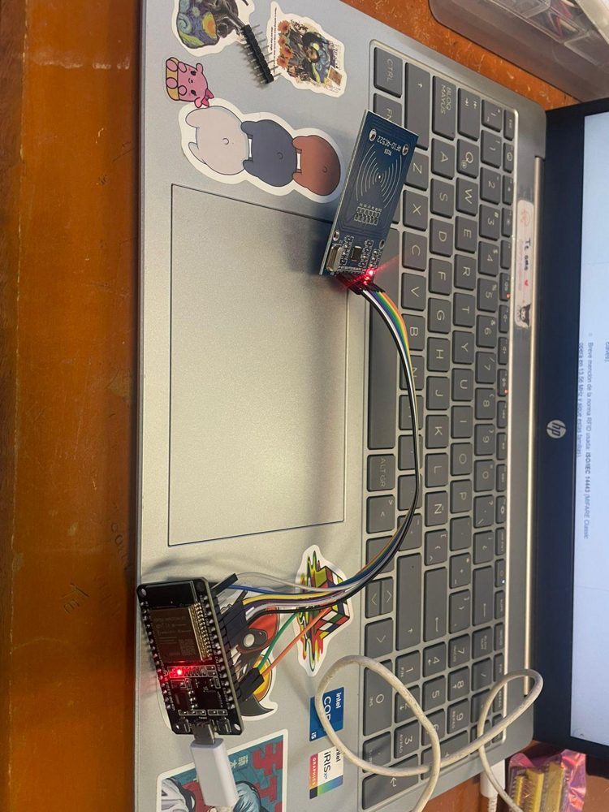
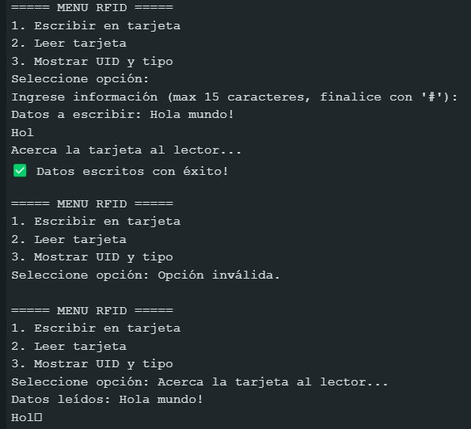
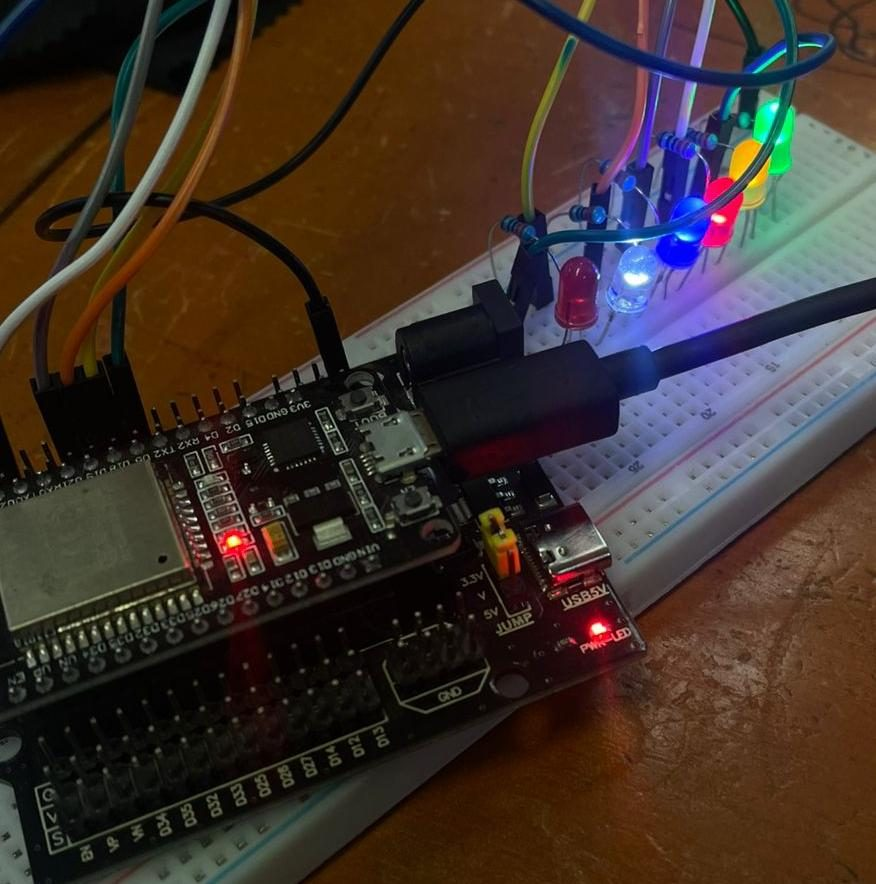
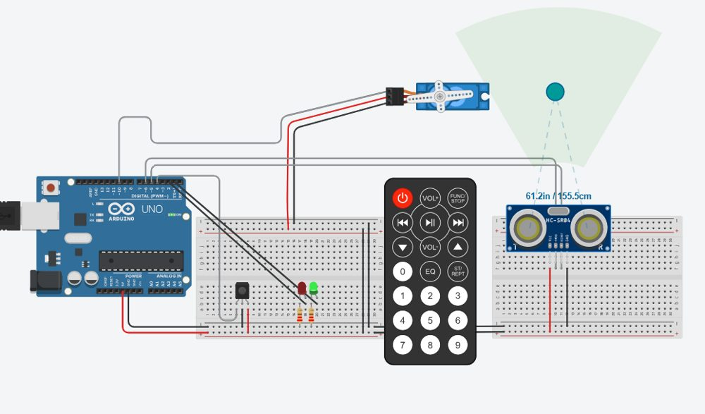

# Proyectos con ESP32 y Arduino

Proyectos funcionales y prácticas de sistemas embebidos de Daniel Ignacio Pedraza Martínez (Ingeniería en Tecnologías de la Información y Comunicaciones, Tecnológico Nacional de México, Campus Pachuca). Los proyectos principales tienen su propio repositorio:
[AURA](https://github.com/nshtpdrz/aura-lampara-rgb-esp32) ·
[Calaverita](https://github.com/nshtpdrz/calaverita-parlante-esp32) ·
[Bocina Inteligente](https://github.com/nshtpdrz/bocina-inteligente-esp32) ·
[Robot 4WD](https://github.com/nshtpdrz/robot-4wd-sumo-seguidor) ·
[Batalla Naval](https://github.com/nshtpdrz/batalla-naval-esp32)

| Carpeta | Proyecto | Placa | Estado |
|---|---|---|---|
| `rfid/` | Lector y escritor RFID MIFARE Classic | ESP32 | Funcional |
| `electronivel/` | Monitor de nivel de agua (electrodos y ultrasonido) | ESP32 · Arduino UNO | Funcional |
| `tamagotchi/` | Mascota virtual en OLED con EEPROM | ESP32 | Funcional |
| `fundamentos-wifi/` | RSSI, LED por web y 6 LEDs con slider | ESP32 | Funcional |
| `pluma-vehicular/` | Pluma con ultrasonido y control IR | Arduino UNO | Simulación |
| `smart-robot-car-kit/` | Smart Robot Car 4 en 1 (kit modificado) | Arduino UNO | Funcional |
| `basicos/` | Semáforos, alarma ultrasónica, botón con flanco | Arduino UNO | Prácticas |

## RFID
Lectura de UID y escritura/lectura del bloque 1 de tarjetas MIFARE Classic, con análisis de riesgos del sector trailer. Pines: SS 5, RST 21, SCK 18, MISO 19, MOSI 23. Librería: MFRC522.

## Electronivel
Monitor de nivel de agua de un tinaco por electrodos (5 niveles, filtro por moda de 5 lecturas) y por ultrasonido con LCD.
- `electronivel/`, `electronivel_5nivelesCGPT/`, `electronivel_5nivelesCLAUDE/`, `electronivelNACHO/`: versiones por electrodos con ESP32 y BluetoothSerial.
- `electronivel_ultrasonico_lcd/`: Arduino UNO + HC-SR04 + LCD I²C + HC-05 (librería LiquidCrystal_I2C).

## Tamagotchi
Mascota virtual en OLED con tres botones, minijuegos, evolución según cuidados y partida guardada en EEPROM. Botones en GPIO 12/13/14, buzzer en 33, OLED SSD1306 por I²C. Librerías: Adafruit SSD1306 y GFX.

## Fundamentos Wi-Fi
Medición de RSSI en el campus, LED controlado desde el navegador, 6 LEDs con slider web y LED por Bluetooth serie. Copia `secrets.example.h` como `secrets.h` en cada carpeta.

## Pluma vehicular
Barrera que sube 45° al detectar un vehículo y que se abre o cierra por completo con control infrarrojo. [Simulación en Tinkercad](https://www.tinkercad.com/things/6RjAkW2elnn-evaluacion-u2?sharecode=sfVD-J4Kjnqxw5WdH3lfJSh7hJJ-T6jAI3IZTtBiVzQ).

## Smart Robot Car 4 en 1
Firmware base del fabricante del kit (seguidor IR, evasión ultrasónica y control IR) con cambios propios: control por Bluetooth y acciones con duración. Las funciones de fábrica están marcadas en los comentarios.

---
Parte del [portafolio técnico](https://github.com/nshtpdrz) de Daniel Ignacio Pedraza Martínez.
